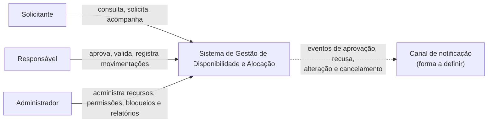
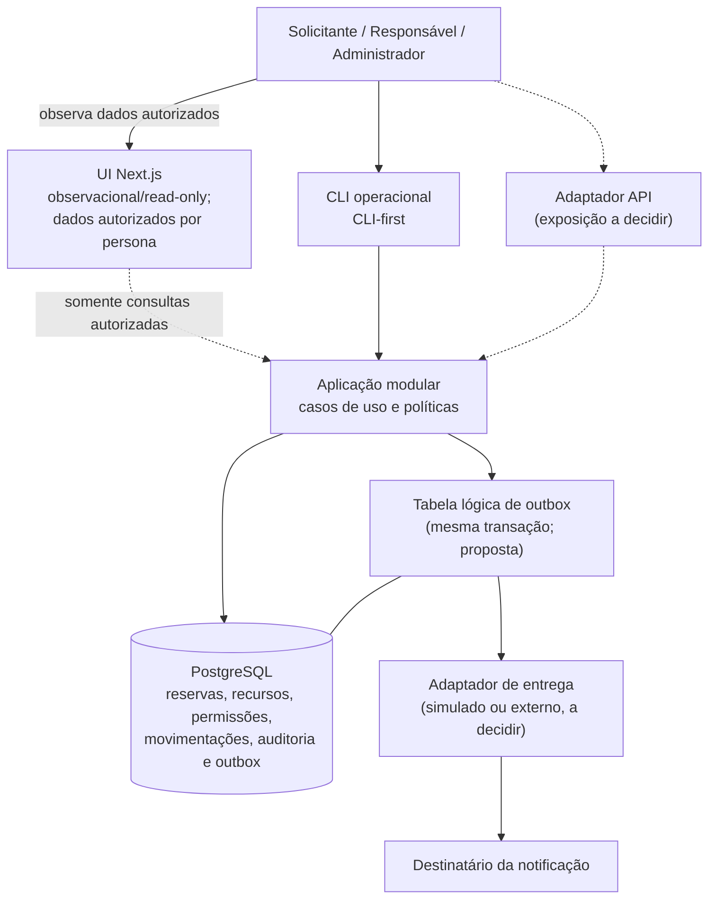
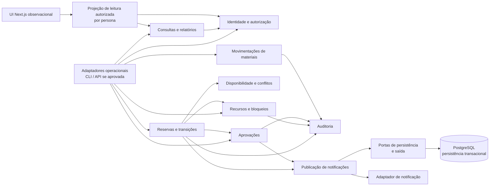

# Arquitetura de Software — Gestão de Disponibilidade e Alocação de Recursos

**Versão:** 0.1
**Status:** Baseline técnica e de superfície ratificada parcialmente (CLI operacional; UI Next.js somente observacional; PostgreSQL). Demais decisões arquiteturais e de produto permanecem propostas ou pendentes; este status não aprova regras de negócio ainda não definidas.
**Data:** 2026-10-22
**Escopo:** Arquitetura lógica do produto descrito no PRD e nos requisitos funcionais e não funcionais. Este documento não altera nem substitui esses artefatos.

## 1. Visão geral e objetivos arquiteturais

O produto centraliza a consulta e administração de salas, professores e materiais; o ciclo de solicitações e reservas; aprovações; movimentações de materiais; auditoria; notificações; e relatórios. A arquitetura precisa preservar a integridade das alocações sob concorrência, aplicar autorização por perfil e escopo e manter histórico rastreável. A decisão de governança ratificada é cumprir a Constituição AIOX Art. I sem exceção: CLI é a superfície operacional e CLI-first; qualquer UI Next.js é estritamente observacional/read-only. Next.js e PostgreSQL foram aprovados como stack, sem versões definidas. Implantação, volume, plataformas e integrações permanecem pendentes.

### Objetivos

1. Não confirmar alocações conflitantes nem reservas incompatíveis com bloqueios.
2. Aplicar autorização no limite do domínio e não depender da interface para proteger dados.
3. Registrar alterações relevantes junto com as operações de negócio, preservando o histórico.
4. Manter regras de reserva, disponibilidade e aprovação em um único caminho de execução coerente.
5. Evitar complexidade operacional não justificada pelo escopo e pelos volumes ainda desconhecidos.
6. Permitir documentar e testar todos os pontos de interação que vierem a ser expostos.

### Decisão de alto nível proposta

Manter como proposta um **monólito modular**, com núcleo de aplicação independente de interfaces e persistência transacional. A superfície operacional é a CLI e deve oferecer as jornadas operacionais do produto. A UI Next.js, se disponibilizada, limita-se à observação: pode consultar/apresentar somente dados autorizados para a persona e não pode aprovar, reservar, editar, cancelar, administrar ou tomar decisões. PostgreSQL é a persistência aprovada. Para notificações, usar uma fronteira de saída substituível e, como proposta, uma fila/outbox transacional; canal e provedor permanecem por decidir.

Foram ratificadas somente a compatibilidade com o Art. I, a superfície operacional/observacional e a stack Next.js + PostgreSQL. A aprovação não fecha as regras de negócio nem as demais pendências listadas em [Pendências e aprovações](#15-pendências-e-aprovações).

## 2. Fontes oficiais e limites

Os requisitos de produto permanecem nas fontes originais:

- [PRD](./prd.md) — visão, escopo, perfis, regras conhecidas, fluxos, exceções e pendências.
- [Requisitos Funcionais](./requisitos-funcionais.md) — FR-01 a FR-12 e FR-14.
- [Requisitos Não Funcionais](./requisitos-nao-funcionais.md) — NFR-01 a NFR-05.
- [Constituição AIOX](../.aiox-core/constitution.md) — restrições do processo/projeto; para este produto, o Art. I foi ratificado sem exceção.

Não se reproduzem nem redefinem os requisitos. Os identificadores citados abaixo mantêm a grafia original. A ratificação de governança não altera PRD, RF ou NRF nem resolve as decisões de produto ainda abertas.

## 3. Requisitos arquiteturalmente significativos (RAS)

| RAS | Requisito de origem | Significado arquitetural |
|---|---|---|
| RAS-01 — Controle de acesso | FR-01, FR-02, FR-03, FR-07, FR-09; NFR-01; PRD §5 e §9 | Autenticação e autorização por perfil e escopo devem ser aplicadas a cada operação e consulta, incluindo acesso a objetos individuais. |
| RAS-02 — Integridade de alocações | FR-04, FR-05, FR-06, FR-07, FR-08; NFR-02; PRD §6, §8 e §9 | Conflito, manutenção e aprovação devem ser verificados antes da confirmação, inclusive sob concorrência e em alterações. |
| RAS-03 — Histórico rastreável | FR-02, FR-04, FR-07, FR-09, FR-10; NFR-03; PRD §5.3, §6 e §9 | Operações relevantes devem conservar ator, instante, ação e dados que contextualizem a mudança; desativação não pode apagar o histórico. |
| RAS-04 — Ciclo de reserva e aprovação | FR-04, FR-07, FR-08; PRD §7.1–§7.3 | Estado pendente/rejeitado não pode ser confundido com reserva confirmada; transições detalhadas ainda precisam ser aprovadas. |
| RAS-05 — Comunicação de eventos | FR-11; PRD §5.1 e §7.1–§7.3 | Comunicações devem corresponder ao estado efetivo; entrega simulada ou integração externa segue em aberto. |
| RAS-06 — Interação utilizável e documentada | FR-03, FR-14; NFR-04, NFR-05; PRD §4.2 e §7 | A CLI é operacional; UI Next.js, se disponibilizada, é somente observacional e respeita a autorização por persona. API, públicos consumidores e documentação permanecem pendentes de definição. |
| RAS-07 — Consulta e indicadores | FR-03, FR-12; PRD §2, §4.1 e §5.3 | Pesquisas e relatórios devem respeitar autorização; fórmula, filtros e períodos do indicador não foram definidos. |
| RAS-08 — Movimentação de materiais | FR-09; NFR-03; PRD §7.4 | Retiradas, devoluções, pendências e ocorrências devem manter vínculo com reserva e material, sob autorização e auditoria. |

### Requisitos sem metas mensuráveis aprovadas

Os documentos não estabelecem limites de latência, volume de usuários ou concorrência, disponibilidade, recuperação, retenção e consulta de auditoria, segurança quantitativa, plataformas ou métricas de usabilidade/acessibilidade. A arquitetura não os trata como metas existentes. São necessários para dimensionar implantação, capacidade e testes de aceitação; valores só podem ser aprovados pelo produto.

## 4. Estilo arquitetural e alternativas

### Estilo recomendado: monólito modular

O escopo reúne fluxos fortemente relacionados e invariantes transacionais entre reservas, recursos, bloqueios, aprovações e auditoria. Não há requisitos de escala independente, equipes autônomas, isolamento regulatório ou disponibilidade por módulo que justifiquem serviços distribuídos. Um processo de aplicação modular reduz pontos de falha, custo operacional e coordenação de transações enquanto permite limites internos explícitos e extração futura, se evidências surgirem.

### Alternativas avaliadas

| Alternativa | Adequação atual | Razão |
|---|---|---|
| Monólito em camadas sem limites de domínio | Não recomendado | Simples de iniciar, mas deixa disponibilidade, autorização e escrita/auditoria propensas a acoplamento transversal. |
| Monólito modular | Recomendado, sujeito a validação | Mantém operações críticas em transações locais e organiza responsabilidades sem complexidade distribuída. |
| Microserviços | Não recomendado agora | Não há requisitos de escala/implantação independente; transações e conflitos entre recursos passariam a depender de coordenação distribuída, aumentando risco e custo. |
| Serverless/funções isoladas | Não selecionado | Pode servir para adaptadores assíncronos, mas não há perfil de carga ou restrição operacional que justifique repartir o núcleo transacional. |
| Arquitetura orientada a eventos como núcleo | Não selecionada | Adequada para integrações assíncronas futuras; reservas e conflitos precisam de resultado transacional claro e imediato, sem confirmação eventual. |

## 5. C4 — Contexto, contêineres e componentes

Os diagramas descrevem a arquitetura lógica; não afirmam implantação, versões de tecnologia, API pública ou canal de notificação definidos. A CLI operacional, a UI Next.js estritamente observacional e PostgreSQL estão ratificados. Os adaptadores de API e notificação permanecem condicionais.

### 5.1. C4 — Contexto



### 5.2. C4 — Contêineres lógicos



### 5.3. C4 — Componentes internos da aplicação



O diagrama é lógico: auditoria e registro de notificações precisam participar de transações locais relevantes, mesmo que suas interfaces internas sejam separadas. O módulo de reservas consulta o resultado do módulo de aprovações; aprovação não pode contornar a validação de disponibilidade nem confirmar diretamente uma reserva.

## 6. Limites, responsabilidades e dependências

| Módulo | Responsabilidade | Regras e dependências |
|---|---|---|
| Adaptadores de entrada | Converter comandos/solicitações em casos de uso; validar formato e apresentar resultados | Sem regras de negócio; não consultar nem alterar o armazenamento diretamente. |
| Identidade e autorização | Resolver ator autenticado, perfil, escopo e permissões para cada ação/objeto | Negação por padrão; autorização no servidor/caso de uso, inclusive em leitura de detalhes. |
| Recursos e bloqueios | Manter salas, professores, materiais, classificações e indisponibilidades administrativas | Desativação preserva referências históricas; alterações relevantes são auditadas. |
| Disponibilidade e conflitos | Avaliar intervalos, recursos associados, reservas confirmadas e bloqueios | Fonte única da decisão de compatibilidade; usada por criação, alteração e confirmação após aprovação. |
| Reservas e transições | Orquestrar solicitação, mudança, cancelamento e estado de confirmação | Aplicar políticas, revalidar disponibilidade e gravar estado/auditoria atomicamente. Estados detalhados ficam pendentes. |
| Aprovações | Registrar decisões e justificativas quando exigidas | Apenas ator autorizado; aprovação é pré-condição, não substituto da validação de disponibilidade. |
| Movimentações | Registrar retirada, devolução, pendência, atraso e ocorrência | Manter vínculo com recurso e reserva; controles de perfil e auditoria. |
| Auditoria | Persistir registro de ator, data/hora, ação, objeto e dados suficientes da mudança | Escrita coordenada com a operação de negócio; leitura e manutenção autorizadas; sem exclusão/alteração ordinária de histórico. |
| Consultas e relatórios | Pesquisa, histórico, conflitos, utilização e horas alocadas | Consultas filtradas por escopo; cálculos de indicadores aguardam fórmula aprovada. |
| Notificações | Produzir comunicações derivadas de eventos de estado | Entrega não é confirmação da reserva; repetição não pode alterar estado de negócio. Transporte ainda não definido. |
| Persistência | Implementar portas de armazenamento e transação | Única via de acesso a dados; transações para invariantes multi-entidade. |

### Regras de dependência

- Dependências apontam dos adaptadores e da aplicação para contratos internos; domínio não depende de interface, provedor de notificação ou detalhes de persistência.
- Módulos não acessam diretamente tabelas/coleções uns dos outros nem criam caminhos alternativos às validações de disponibilidade/autorização.
- Escritas de reserva, aprovação, bloqueio, movimentação e auditoria passam pelos casos de uso correspondentes.
- Relatórios não podem enfraquecer autorização nem alterar o estado de negócio.
- A extração de um módulo para processo/serviço separado requer evidência de necessidade e desenho de consistência revisado; não é parte desta proposta.

## 7. Dados, transações e concorrência

### Persistência proposta

Usar PostgreSQL como persistência relacional transacional, sem selecionar versão. O modelo conceitual precisa representar usuários/permissões, tipos e instâncias de recursos, bloqueios, reservas e recursos associados, decisões, movimentações, auditoria e estado de entrega de notificações. Relacionamentos preservam a identidade histórica dos recursos desativados; não se presume exclusão física.

A escolha relacional é motivada por relações entre reservas e múltiplos recursos, histórico consultável e necessidade de atomicidade e isolamento, não por popularidade. A avaliação de volume, retenção, disponibilidade e implantação poderá alterar a escolha após validação.

### Protocolo de confirmação de reserva

1. Autenticar o ator e autorizar a ação e o escopo do objeto.
2. Validar entrada, transição permitida e requisitos de aprovação aplicáveis.
3. Iniciar uma transação; revalidar bloqueios e todas as alocações conflitantes para cada recurso no intervalo.
4. Serializar operações concorrentes que disputem os mesmos recursos, com bloqueio/controle transacional coerente no armazenamento e ordem estável de aquisição quando houver vários recursos.
5. Gravar reserva/transição e auditoria na mesma transação; tornar a reserva confirmada visível somente após commit.
6. Em conflito, abortar a operação concorrente sem alterar a reserva anterior e devolver resultado explícito não confirmado.

A implementação deve garantir no armazenamento ou protocolo transacional que não exista janela de corrida entre “verificar” e “confirmar”. Uma simples consulta prévia na camada de interface ou aplicação não é suficiente. A técnica específica (nível de isolamento, locks, restrição temporal ou mecanismo equivalente) depende do banco escolhido e precisa ser comprovada em teste de concorrência. Reservas com múltiplos recursos devem ser atômicas: confirmar todos os recursos requeridos ou nenhum.

**Premissa proposta para validação:** representar intervalos como semiabertos `[início, fim)` para definir sobreposição sem conflito em fronteiras contíguas. O PRD/FR-05 deixa a regra de limites em aberto; não se deve implementá-la antes de aprovação.

### Auditoria e retenção

Cada operação de negócio relevante grava auditoria com ator autenticado, instante, ação, objeto, resultado e dados necessários para compreender a mudança, em conformidade com o conteúdo mínimo de FR-10/NFR-03. Para evitar sucesso sem trilha, a gravação é atômica com a operação auditada. Registros são append-only para os fluxos ordinários; correções, se permitidas, devem criar novo evento relacionado, não reescrever o passado. Retenção, mascaramento e acesso administrativo aos registros ainda precisam de política aprovada.

### Relatórios e consistência de leitura

Relatórios podem usar consultas derivadas do estado transacional. Até que volume e metas de latência sejam definidos, recomenda-se leitura consistente do armazenamento primário e consultas pagináveis/limitadas; não se propõe cache, réplicas ou atualização eventual para disponibilidade. Qualquer otimização futura deve preservar autorização e declarar a defasagem observável. Fórmula e período de “conflitos evitados” aguardam definição do produto (FR-12).

## 8. Segurança, autorização e auditoria

- Autenticação deve produzir identidade confiável de ator; mecanismo, sessão e provedor não estão definidos pelos requisitos.
- Aplicar autorização por perfil **e** escopo de responsabilidade em toda consulta e mutação; conferir acesso ao objeto solicitado, não apenas à rota ou tela.
- Negar por padrão ações sem regra explícita. Não confiar em campos de perfil, identificador de ator ou decisão de autorização enviados pelo cliente.
- Revalidar permissão imediatamente antes da operação, inclusive em decisões de aprovação e ações administrativas; registrar decisões administrativas e exceções.
- Não permitir que aprovação ignore conflito, bloqueio ou manutenção.
- Respostas e mensagens devem explicar a condição observável sem revelar reservas ou dados fora do escopo do ator (NFR-04).
- Aplicar minimização de dados em logs técnicos; auditoria de negócio não deve armazenar segredos de autenticação. Regras de retenção e classificação de dados são pendentes, não requisitos aprovados.
- A auditoria de negócio é separada conceitualmente dos logs operacionais: logs técnicos apoiam diagnóstico; não substituem FR-10/NFR-03.

## 9. Falhas, erros e integrações

### Falhas de operações internas

- Erros de validação, negação de permissão, conflito, bloqueio e falha transitória devem ter resultados distinguíveis, sem sucesso implícito nem estado “talvez confirmado”.
- Uma falha antes do commit não pode deixar alteração parcial nem evento de auditoria de sucesso. Se o commit ocorreu mas a resposta se perdeu, a consulta posterior deve revelar o resultado confirmado; detalhes de idempotência e contrato de interação precisam ser definidos ao escolher API/CLI/UI.
- Mensagens ao usuário devem indicar causa observável e próximo passo quando aplicável, sem expor dados restritos.
- Erros internos devem ser correlacionáveis com identificador de requisição/operação sem replicar dados sensíveis; formato e retenção de logs não foram determinados.

### Notificações

Como proposta, registrar o evento de saída na mesma transação do estado de negócio (outbox) e fazer entrega assíncrona após commit. Assim, indisponibilidade de provedor não desfaz uma reserva válida nem envia notificação de estado que não foi confirmado. A entrega pode ser repetida e deve ser idempotente; falhas persistentes precisam ser observáveis e tratáveis por operação. A escolha entre notificação simulada e integração externa, canal, prazos, política de repetição e destinatários permanecem pendentes (FR-11).

### Integrações externas

Nenhuma integração externa é requisito confirmado. Qualquer provedor futuro fica atrás de adaptador, com timeout, tratamento explícito de indisponibilidade e credenciais fora do código. A integração não pode conceder, por falha, aprovação ou confirmação de reserva. Se não houver integração aprovada, o adaptador pode ser simulado conforme a decisão de produto; isso não equivale a definir um canal de produção.

## 10. Atributos de qualidade e ATAM

### 10.1. Priorização

Priorização arquitetural proposta, derivada dos requisitos; não cria novos compromissos de produto.

| Prioridade | Atributo | Base | Justificativa |
|---|---|---|---|
| P1 | Integridade/consistência | NFR-02; FR-04–FR-08 | Invariante explícito de não haver dupla reserva ou confirmação durante bloqueio. |
| P1 | Segurança e autorização | NFR-01; FR-01, FR-02, FR-03, FR-07 e FR-09 | Exposição ou mutação não autorizada é explicitamente proibida. |
| P1 | Auditabilidade | NFR-03; FR-10 | Histórico de operações relevantes é obrigatório e deve sobreviver a mudanças/desativação. |
| P2 | Usabilidade e clareza de erro | NFR-04; PRD §1 e §7 | Responsividade e explicação de erros são obrigatórias; plataformas e medidas ainda abertas. |
| P2 | Modificabilidade/testabilidade | Necessidade derivada da pendência de tecnologia/regras e da variedade de fluxos | Proposta arquitetural para evoluir regras e validar invariantes; não é NFR numerado. |
| P2 | Documentação de interação | NFR-05; FR-14 | Obrigatória para as superfícies que forem efetivamente expostas. |
| A definir | Desempenho, capacidade e disponibilidade | Sem metas nos requisitos atuais | Não priorizar como garantia nem estabelecer limiares sem validação. Devem ser avaliados para decisões de dimensionamento. |

### 10.2. Árvore de utilidade

Escalas **Alta/Média/Baixa** de prioridade de negócio e dificuldade são avaliações ATAM desta proposta, não metas ou prioridades formalmente aprovadas. Medidas qualitativas são verificáveis pelos critérios dos requisitos; limiares quantitativos permanecem a definir.

```text
Utilidade
├── Integridade / consistência [P1]
│   ├── duas solicitações simultâneas disputam o mesmo recurso [Alta / Alta] — NFR-02, FR-05, FR-06
│   ├── alteração disputa recursos e a reserva anterior deve sobreviver [Alta / Alta] — NFR-02, FR-04
│   └── bloqueio/manutenção coincide com aprovação [Alta / Média] — NFR-02, FR-07, FR-08
├── Segurança / autorização [P1]
│   ├── solicitante tenta ler ou alterar reserva alheia [Alta / Média] — NFR-01, FR-01, FR-03, FR-04
│   └── responsável não autorizado tenta aprovar ou registrar movimentação [Alta / Média] — NFR-01, FR-07, FR-09
├── Auditabilidade [P1]
│   ├── operação relevante completa e recurso é depois desativado [Alta / Média] — NFR-03, FR-02, FR-10
│   └── auditor autorizado reconstrói decisão/mudança [Alta / Média] — NFR-03, FR-10
├── Usabilidade [P2]
│   ├── usuário recebe conflito, indisponibilidade ou recusa [Média / Média] — NFR-04
│   └── fluxo é usado em plataforma/dispositivo alvo [Média / Média] — NFR-04 (alvos a definir)
└── Documentação / modificabilidade [P2]
    ├── ponto público é exposto ou alterado [Média / Baixa] — NFR-05, FR-14
    └── nova regra de negócio precisa preservar invariantes [Média / Média] — proposta arquitetural
```

### 10.3. Cenários de qualidade mensuráveis

| ID / atributo | Estímulo e origem | Ambiente | Resposta esperada e medida verificável | Prioridade / dificuldade | Rastreabilidade |
|---|---|---|---|---|---|
| AT-01 Integridade concorrente | Duas ou mais solicitações simultâneas tentam confirmar intervalos conflitantes do mesmo recurso; solicitantes concorrentes. | Operação normal, com transações concorrentes. | No máximo uma alocação conflitante fica confirmada; demais retornam conflito/indisponibilidade sem estado ambíguo. Verificar estado final persistido para sala, professor e material. Volume e latência: a definir. | Alta / Alta | NFR-02, FR-05, FR-06 |
| AT-02 Integridade em alteração | Solicitante tenta mover reserva para período/recurso bloqueado ou ocupado. | Operação normal. | Alteração incompatível não é confirmada e a reserva vigente permanece válida e consultável. | Alta / Alta | NFR-02, FR-04, FR-05, FR-08 |
| AT-03 Autorização de objeto | Solicitante tenta consultar ou alterar reserva de terceiro; usuário sem permissão tenta acessar administração. | Sessão autenticada com perfil/escopo distintos. | Acesso negado, zero mutação; resultado não revela dados protegidos. Validar matriz de operações para os três perfis. | Alta / Média | NFR-01, FR-01 |
| AT-04 Aprovação sob restrição | Usuário sem autorização tenta aprovar; usuário autorizado tenta aprovar uma solicitação com conflito/bloqueio. | Fluxo de aprovação em operação. | A primeira ação é negada; a segunda não confirma reserva que viole disponibilidade. Decisão/negação registrada conforme escopo de auditoria aplicável. | Alta / Média | NFR-01, NFR-02, FR-07, FR-08, FR-10 |
| AT-05 Trilha de auditoria | Reserva/aprovação/movimentação/administração é alterada e recurso depois desativado. | Operação normal e leitura posterior por auditor autorizado. | Registro contém ator, data, ação, objeto e dados da mudança; continua relacionado e consultável após desativação. Retenção e tempo de consulta: a definir. | Alta / Média | NFR-03, FR-02, FR-09, FR-10 |
| AT-06 Falha de armazenamento | Persistência falha antes do commit de uma reserva e auditoria. | Falha transitória durante operação. | Não há reserva parcialmente confirmada nem sucesso apresentado; estado prévio permanece. Uma falha após commit deve ser distinguível por consulta do estado efetivo. Critério de recuperação/tempo: a definir. | Alta / Alta | NFR-02, NFR-03, FR-04, FR-06, FR-10 |
| AT-07 Falha de notificação | Destino de notificação está indisponível depois de uma aprovação/alteração confirmada. | Integração configurada e indisponível. | Estado confirmado permanece consistente; mensagem não afirma estado diferente; falha fica observável e entrega pode ser tentada novamente sem duplicar efeito de negócio. Prazo de entrega: a definir. | Média / Média | FR-11, NFR-04; estratégia proposta |
| AT-08 Aumento de carga | Cresce o número de pesquisas, relatórios e reservas concorrentes. | Carga além do perfil de referência, ainda não definido. | Sistema preserva autorização e invariantes; latência, throughput, usuários simultâneos e comportamento de saturação só podem ser aprovados após definição de metas e capacidade. Não se atribui SLA nesta proposta. | A definir / Alta | FR-03, FR-06, FR-12; NFR-02 |
| AT-09 Erro de validação/permissão/conflito | Usuário encontra recusa ou indisponibilidade durante um fluxo público. | Dispositivo/plataforma suportados, ainda a definir. | Mensagem identifica motivo observável e ação possível sem expor dado restrito; conteúdo e controles não sofrem sobreposição/perda de informação nos alvos aprovados. | Média / Média | NFR-04 |
| AT-10 Documentação de superfície | API ou fluxo público é disponibilizado/alterado. | Revisão de release da superfície. | Todo ponto efetivamente exposto tem documentação correspondente, e comportamento documentado coincide com comportamento observado. Formato/processo: a definir. | Média / Baixa | NFR-05, FR-14 |

## 11. Cenários críticos e resposta arquitetural

| Cenário crítico | Resposta da arquitetura | Decisão/validação necessária |
|---|---|---|
| Falha durante confirmação | Commit único para reserva e auditoria; rollback antes do commit; estado consultável para resultado de commit cuja resposta se perdeu. | Definir contrato de idempotência por superfície e comportamento de recuperação/observabilidade. |
| Concorrência por sala, professor ou material | Serializar contendores no limite transacional do armazenamento; revalidar todos os recursos/bloqueios e confirmar atomicamente. | Escolher persistência e estratégia concreta de isolamento/lock; executar testes concorrentes sob carga aprovada. |
| Acesso não autorizado | Verificação de perfil e escopo em cada caso de uso e objeto, negação padrão, sem mutação e mensagem que não vaze informação. | Definir atribuição, delegação, acumulação de perfis e detalhes da política (FR-01/NFR-01). |
| Inconsistência por aprovação versus bloqueio | Aprovação registra decisão; confirmação passa novamente pelo mesmo serviço de disponibilidade e bloqueios. | Definir estados/transições e o que ocorre se disponibilidade mudar enquanto a solicitação aguarda aprovação. |
| Recurso desativado com reservas/histórico | Desativar logicamente, manter referência histórica e impedir remoção que destrua vínculos. | Aprovar política de retenção e comportamento de reservas futuras vinculadas ao recurso. |
| Indisponibilidade de notificação | Outbox proposta mantém evento com a transação e permite entrega posterior/repetida; estado de reserva não depende da entrega. | Escolher canal/provedor, prazo, política de repetição, monitoramento e alternativa simulada ou externa. |
| Crescimento de carga | Monólito modular não impede dimensionamento vertical/horizontal futuro; separar leitura ou processamento apenas após medição. | Aprovar volumetria, concorrência, latência, disponibilidade e custo antes de dimensionar ou selecionar infraestrutura. |

## 12. Matriz ATAM: decisões, riscos, sensibilidades e trade-offs

| Decisão arquitetural | Requisito associado | Atributos afetados / ponto de sensibilidade | Risco ou não risco | Consequência / trade-off | Mitigação recomendada |
|---|---|---|---|---|---|
| Monólito modular em vez de serviços distribuídos | FR-04–FR-10; NFR-02, NFR-03 | Integridade, modificabilidade, disponibilidade | **Não risco identificado:** não há evidência atual que justifique distribuição. **Risco:** acoplamento interno pode crescer. | Favorece transação local e operação simples; limita escala independente por módulo. | Limites e dependências explícitos, testes de arquitetura e extração somente com evidência. |
| PostgreSQL como persistência relacional transacional (ratificado) | FR-04–FR-10; NFR-02, NFR-03 | Consistência é sensível a isolamento, locks e índices; consulta pode afetar escrita. | Risco se a estratégia implementada não garantir serialização de disputas ou histórico confiável. | Transações e relações explícitas; capacidade, retenção e custo ainda sem dimensionamento. | Provar concorrência com testes de integração no PostgreSQL; validar volume, recuperação e retenção antes de dimensionar. |
| Reserva e auditoria na mesma transação | FR-04, FR-06, FR-10; NFR-02, NFR-03 | Integridade vs. disponibilidade/latência de escrita | Risco: falha na gravação da auditoria impede operação de negócio. | Evita sucesso sem trilha; aumenta acoplamento temporal e custo de commit. | Tratar auditoria como requisito de persistência do caso de uso; observar falhas e testar rollback. |
| Autorização por perfil + escopo em casos de uso | FR-01–FR-03, FR-07, FR-09; NFR-01 | Segurança vs. usabilidade e complexidade de política | Risco de acesso indevido por lacuna em consulta indireta ou permissão ambígua. | Controle consistente além da UI; política fica dependente de regras de negócio ainda incompletas. | Matriz aprovada de permissões, negação padrão e testes positivos/negativos por objeto e perfil. |
| Outbox transacional e adaptador de entrega (proposta) | FR-11; NFR-04 | Consistência da comunicação vs. latência/complexidade operacional | Risco de acúmulo ou duplicação de mensagens em indisponibilidade; canal ainda não escolhido. | Reserva não depende de serviço externo; entrega pode ser atrasada. | Idempotência, estado de entrega observável, política de tentativas e critérios de retenção aprovados. |
| CLI operacional e UI Next.js observacional | FR-03, FR-14; NFR-01, NFR-04, NFR-05; Constituição AIOX Art. I | Usabilidade, autorização, documentação e modificabilidade. | Risco de UI oferecer mutações ou expor dados fora do escopo de uma persona. | CLI atende as jornadas operacionais; UI opcional oferece apenas observação dos dados autorizados. | Aplicar autorização em cada consulta da UI; restringir UI a leitura; testar que não há operações de escrita/decisão e manter jornadas operacionais na CLI. |
| Desativação lógica e referências históricas | FR-02, FR-10; NFR-03 | Auditabilidade vs. esforço de consulta e retenção | Risco se políticas futuras apagarem registros ou vínculo histórico. | Preserva trilha; exige política de ciclo de vida e tratamento de dados. | Proibir remoção ordinária de histórico; aprovar retenção, anonimização e controles administrativos. |
| Intervalo semiaberto `[início,fim)` proposto | FR-05; NFR-02 | Consistência e previsibilidade nos limites do intervalo | **Risco aberto:** regra não aprovada; escolhas diferentes alteram compatibilidade. | Convenção simples para intervalos contíguos; altera resultados de fronteira. | Produto aprova regra de limites antes do desenvolvimento e inclui casos-limite nos testes. |
| Sem cache ou réplica de leitura inicialmente | FR-03, FR-12; NFR-01, NFR-02 | Consistência/autorização vs. desempenho | **Não risco de requisito conhecido:** não existe meta de desempenho que exija cache; desempenho futuro é risco não quantificado. | Leituras mais atuais e menos componentes; consultas pesadas podem competir com escritas. | Medir com dados representativos após requisitos de desempenho; projetar otimização sem enfraquecer autorização/consistência. |
| Sem SLA, latência ou capacidade presumidos | NFR-02 e pendências de NFR | Desempenho, disponibilidade, custo | Risco de arquitetura subdimensionada se metas forem introduzidas tarde; não há requisito quantificado aprovado. | Evita compromisso inventado; impede fechar topologia e sizing. | Produto aprova SLOs, carga esperada e recuperação como pendência antes de dimensionamento. |

### Pontos de sensibilidade mais relevantes

1. **Mecanismo de concorrência no armazenamento:** mudança em isolamento/locking pode invalidar a garantia central de NFR-02.
2. **Semântica de intervalo e estados:** definição de intervalos, cancelamento e transições altera detecção de conflito e reaprovação.
3. **Granularidade de autorização:** delegação e acumulação de perfis afetam tanto segurança quanto consultas e fluxos.
4. **Atomicidade entre domínio e auditoria:** separar auditoria em outro processo/banco enfraquece a garantia de trilha caso não haja protocolo equivalente.
5. **Superfícies de interação:** CLI operacional e UI Next.js observacional foram ratificadas; eventual API, públicos consumidores e fluxos públicos ainda alteram custo, usabilidade e documentação.
6. **Política de notificações e retenção:** canal, repetição, prazo e dados enviados influenciam confiabilidade e exposição de informação.

## 13. Registros de decisões arquiteturais (ADR)

Os ADRs abaixo registram decisões **propostas**, não ratificadas. “Decisão” indica recomendação arquitetural para validação; não autoriza implementação antes de resolver as pendências impeditivas.

### ADR-001 — Monólito modular

- **Status:** Proposto.
- **Contexto:** Fluxos estreitamente relacionados precisam preservar conflitos, aprovações, bloqueios e auditoria. Escala, autonomia de implantação e equipes não foram especificadas.
- **Alternativas:** monólito sem módulos; monólito modular; microserviços; funções isoladas.
- **Decisão proposta:** organizar em monólito modular com limites de domínio e transações locais.
- **Consequências:** menor custo distribuído e melhor atomicidade inicial; exige disciplina de dependências. Extração futura fica condicionada a evidência.
- **Rastreabilidade:** FR-04–FR-10; NFR-02, NFR-03.

### ADR-002 — Consistência transacional para alocações

- **Status:** Proposto; PostgreSQL foi selecionado, mas o mecanismo físico de coordenação ainda precisa ser implementado e comprovado.
- **Contexto:** Verificação em leitura separada da confirmação está sujeita a corrida.
- **Alternativas:** checagem somente na aplicação; serialização/lock transacional; restrição temporal no armazenamento; consistência eventual.
- **Decisão proposta:** usar PostgreSQL como persistência relacional transacional e coordenar disputas para revalidar disponibilidade e gravar estado/auditoria atomicamente.
- **Consequências:** confirmação inequívoca e preservação da reserva vigente; maior contenção em recursos disputados e necessidade de teste específico no banco escolhido.
- **Rastreabilidade:** FR-04, FR-05, FR-06, FR-08; NFR-02.

### ADR-003 — Autorização no limite dos casos de uso

- **Status:** Proposto; política detalhada aguarda produto.
- **Contexto:** Perfis têm escopos de atuação e dados de terceiros precisam ser protegidos em consultas e operações.
- **Alternativas:** autorização somente na interface; checagem central por caso de uso/objeto; regras ad hoc em cada adaptador.
- **Decisão proposta:** autenticar antes do caso de uso e aplicar autorização central por perfil, escopo e objeto em cada leitura/mutação.
- **Consequências:** proteção consistente entre superfícies; requer uma matriz de permissão e escopo aprovada.
- **Rastreabilidade:** FR-01–FR-03, FR-07, FR-09; NFR-01.

### ADR-004 — Auditoria coordenada com a operação

- **Status:** Proposto.
- **Contexto:** Falha de auditoria não pode produzir operação relevante sem trilha; recursos desativados não removem registros.
- **Alternativas:** logs técnicos; auditoria em transação local; auditoria assíncrona independente.
- **Decisão proposta:** persistir evento de auditoria no mesmo commit da alteração; manter fluxo ordinário append-only e vínculo histórico.
- **Consequências:** evita escrita parcial entre estado e trilha; aumenta requisitos de disponibilidade da persistência e de política de retenção.
- **Rastreabilidade:** FR-02, FR-04, FR-07, FR-09, FR-10; NFR-03.

### ADR-005 — Notificação desacoplada do commit de negócio

- **Status:** Proposto; canal não decidido.
- **Contexto:** FR-11 exige comunicação de eventos mas deixa em aberto simulação ou API externa.
- **Alternativas:** envio síncrono antes do commit; envio síncrono após o commit; outbox transacional e entrega assíncrona.
- **Decisão proposta:** outbox na mesma transação do evento de negócio e adaptador substituível para canal aprovado.
- **Consequências:** falha externa não invalida reserva; entrega pode atrasar ou ser repetida, exigindo idempotência e operação de pendências.
- **Rastreabilidade:** FR-11; NFR-04 como requisito de mensagem clara, sem inferir prazo de entrega.

### ADR-006 — Contratos de interação independentes do núcleo

- **Status:** Superfície ratificada; exposição de API e detalhes dos fluxos ainda pendentes.
- **Contexto:** Constituição AIOX Art. I foi ratificado sem exceção: CLI-first, CLI operacional e UI somente observacional. FR-14/NFR-05 deixam a exposição de API e os públicos consumidores em aberto; NFR-04 aplica-se às interfaces disponibilizadas.
- **Alternativas:** CLI operacional com UI read-only (selecionada); UI operacional (rejeitada por incompatibilidade com o Art. I); API (exposição ainda não decidida).
- **Decisão ratificada:** todas as jornadas operacionais — incluindo solicitar, reservar, aprovar, editar, cancelar, administrar e movimentar — devem ser atendidas pela CLI. Qualquer UI Next.js será estritamente read-only: pode apresentar somente dados autorizados para a persona e não pode executar operações, decisões ou mutações. A UI não substitui nem é requisito para operação. API continua sujeita a decisão própria e não altera a exigência de CLI operacional.
- **Consequências:** mantém as operações sob a prioridade constitucional; a projeção de leitura da UI precisa aplicar autorização por perfil/escopo e filtrar dados. Não se presume que todos os fluxos internos devam ser expostos na UI.
- **Rastreabilidade:** FR-03, FR-14; NFR-04, NFR-05; Constituição AIOX Art. I.

### ADR-007 — Stack aprovada: Next.js e PostgreSQL

- **Status:** Ratificado; versões e ambiente de implantação não definidos.
- **Contexto:** O usuário aprovou Next.js + PostgreSQL como stack. A Constituição AIOX Art. I limita qualquer UI à observabilidade/read-only e mantém a CLI como superfície operacional.
- **Decisão ratificada:** usar Next.js para eventual UI estritamente observacional e PostgreSQL como banco relacional transacional. Não se fixa versão nem se infere escolha de framework/linguagem da CLI, ORM, hospedagem ou topologia.
- **Consequências:** consultas da UI devem ser somente de leitura e respeitar autorização por persona; PostgreSQL fornece a base relacional transacional, mas a estratégia concreta de concorrência deve ser validada com testes de integração no banco escolhido.
- **Rastreabilidade:** FR-01, FR-03, FR-06, FR-14; NFR-01, NFR-02, NFR-04, NFR-05; Constituição AIOX Art. I.

## 14. Estratégia de testes arquiteturais

Os testes abaixo validam decisões propostas e critérios existentes; limites quantitativos não devem ser inventados para fazê-los passar.

| Tipo de teste | O que verificar | Referência |
|---|---|---|
| Testes de contrato/dependência de módulos | Módulos não acessam persistência uns dos outros nem ignoram casos de uso; adaptadores não contêm regras de domínio. | Limites de [Responsabilidades](#6-limites-responsabilidades-e-dependências); ADR-001/006. |
| Testes de integração transacional | Conflito concorrente para sala, professor e material; alteração incompatível preserva reserva; bloqueio impede confirmação; rollback não deixa escrita parcial. | FR-04–FR-08; NFR-02; AT-01, AT-02, AT-06. |
| Testes de isolamento sob concorrência | Repetir disputas simultâneas no PostgreSQL; confirmar ausência de dupla reserva e resultado não ambíguo. | FR-06; NFR-02; ADR-002. |
| Matriz de autorização | Para os três perfis, testar permissões positivas/negativas em lista, detalhe, pesquisa, mutação, aprovação, movimentação e administração. Confirmar zero alteração negada e não exposição de informação. | FR-01–FR-03, FR-07, FR-09; NFR-01. |
| Limites da UI Next.js | Verificar que a UI não oferece operações de escrita/decisão (incluindo aprovação, reserva, edição, cancelamento e administração) e que cada persona só observa dados autorizados. | ADR-006/007; NFR-01, NFR-04. |
| Testes de auditoria | Verificar ator, data/hora, ação, objeto e dados da mudança; atomicidade com a operação; leitura autorizada; persistência do vínculo após desativação. | FR-02, FR-10; NFR-03; ADR-004. |
| Testes de falha/repetição de notificação | Interromper entrega, retomar/repetir e verificar estado de negócio inalterado, mensagem alinhada e ausência de duplicação de efeito. | FR-11; ADR-005. |
| Testes de usabilidade responsiva e erro | Executar jornadas e cenários de conflito, indisponibilidade, validação e permissão nos dispositivos/plataformas aprovados; verificar conteúdo utilizável e mensagens sem vazamento. | NFR-04; plataformas e critérios a definir. |
| Verificação de documentação | Comparar pontos de interação efetivamente expostos com documentação e comportamento observável. | FR-14; NFR-05. |
| Testes de carga e resiliência | Definir perfil de carga e metas com o produto antes; então validar saturação, latência, throughput, falha e recuperação sem quebrar invariantes. | NFR-02 e pendências quantitativas. |

## 15. Pendências e aprovações

### Bloqueiam o fechamento da arquitetura

1. **Estados e transições:** aprovar ciclo de vida da solicitação, momentos de confirmação, cancelamento, revalidação após aprovação e comportamento de alteração (PRD §10; FR-04, FR-07).
2. **Permissões:** aprovar granularidade, delegação, acumulação de perfis, escopos e definição de responsável autorizado (PRD §5; FR-01; NFR-01).
3. **Intervalos:** aprovar regra de fronteira, fuso horário, precisão e interpretação de sobreposição. `[início,fim)` é apenas premissa proposta (FR-05).
4. **Superfícies públicas ainda abertas:** decidir se haverá API, seus consumidores e quais fluxos públicos/documentação são aplicáveis. A CLI operacional e a UI Next.js somente observacional já foram ratificadas (FR-14; NFR-04, NFR-05).
5. **Notificações:** escolher simuladas ou integração externa; canal, destinatário, conteúdo, prazo e repetição (FR-11).

### Necessárias para implantação, dimensionamento ou aceite

6. Definir carga esperada, concorrência, metas de desempenho, disponibilidade e comportamento de recuperação (NFR-02 e pendências de NFR).
7. Definir política de auditoria: retenção, consulta, segregação, privacidade e eventuais correções (FR-10; NFR-03).
8. Definir plataformas, dispositivos, dimensões de tela, critérios de acessibilidade e métricas de usabilidade (NFR-04).
9. Definir fórmula, período, filtros e interpretação do indicador de conflitos evitados e relatórios (FR-12).
10. Definir regras operacionais de retirada/devolução, prazo, atrasos e ocorrências (FR-09).
11. Definir ambiente de implantação/operação, custo, integração e versões de componentes; a aprovação de Next.js e PostgreSQL não seleciona versões nem topologia.

### Inconsistências e ambiguidades observadas — validar sem alterar as fontes

- A sequência dos requisitos funcionais passa de **FR-12 para FR-14**; FR-13 não consta no documento recebido. NFR-05 cita FR-14. Não se infere nem cria conteúdo para FR-13.
- O PRD está em status **Rascunho** e declara requisitos detalhados pendentes em §10–§11, enquanto documentos separados de RF e NRF já apresentam requisitos obrigatórios. Confirmar se estes documentos complementares são a baseline aprovada para arquitetura.
- PRD §5 descreve permissões esperadas, mas delegação, acumulação e granularidade estão pendentes; não é possível fechar matriz de autorização.
- FR-05 deixa a regra de limites dos intervalos indefinida; a semântica afeta a definição de conflito.
- FR-11 admite notificação simulada ou integração; a arquitetura só pode fixar uma porta e o comportamento de consistência, não transporte/prazo.
- FR-12 exige “conflitos evitados”, mas não define fórmula, período ou filtros; não é possível determinar o cálculo.
- FR-14/NFR-05 deixam indefinidos a eventual API, os públicos consumidores e formato/processo documental; a decisão CLI operacional e UI observacional não presume API pública nem define todos os fluxos de leitura da UI.
- NFR-02 exige integridade sob concorrência, mas não fixa volume ou latência; mecanismo pode ser concebido, sizing/limiar não.

## 16. Rastreabilidade resumida

| Requisito original | Elementos arquiteturais relacionados |
|---|---|
| FR-01 | Identidade e autorização; ADR-003; AT-03/04; matriz de autorização. |
| FR-02 | Recursos e bloqueios; desativação lógica; auditoria transacional; AT-05. |
| FR-03 | Adaptadores, autorização por objeto, módulo de pesquisa; AT-03/09. |
| FR-04 | Reservas/transições; transação de confirmação; preservação da reserva vigente; AT-01/02/06. |
| FR-05 | Serviço único de disponibilidade; validação de intervalos; premissa de fronteira pendente; AT-01/02. |
| FR-06 | Coordenação transacional de disputas; ADR-002; AT-01. |
| FR-07 | Módulo de aprovação e autorização; revalidação no momento de confirmar; AT-04. |
| FR-08 | Recursos/bloqueios e serviço de disponibilidade; aprovação não contorna bloqueio; AT-02/04. |
| FR-09 | Módulo de movimentação, vínculo histórico e autorização; AT-05. |
| FR-10 | Módulo de auditoria atômica e append-only; ADR-004; AT-05/06. |
| FR-11 | Porta de notificação/outbox proposta; ADR-005; AT-07. |
| FR-12 | Módulo de consultas/relatórios; fórmula aguardando validação; AT-08. |
| FR-14 | Adaptadores documentados conforme superfície aprovada; ADR-006; AT-10. |
| NFR-01 | Autorização de perfil/escopo/objeto; ADR-003; AT-03/04. |
| NFR-02 | Persistência ACID, coordenação concorrente, revalidação e resposta inequívoca; ADR-002; AT-01/02/06/08. |
| NFR-03 | Auditoria transacional, vínculo histórico e acesso autorizado; ADR-004; AT-05. |
| NFR-04 | Adaptadores de interface, mensagens seguras e testes responsivos; ADR-006; AT-07/09. |
| NFR-05 | Inventário e documentação de todas as superfícies realmente expostas; ADR-006; AT-10. |

## 17. Diretrizes para agentes de implementação

Aplicáveis somente depois da aprovação das pendências que afetam o escopo:

1. Tratar PRD, RF e NRF como baseline; não renomear identificadores nem criar regra de negócio sem aprovação.
2. Preservar limites modulares e manter regras de negócio fora de adaptadores.
3. Toda criação/alteração/confirmação de reserva deve passar pela mesma verificação de autorização, disponibilidade, intervalos e bloqueios.
4. Não implementar a verificação de conflito como consulta desconectada da gravação; demonstrar atomicidade sob concorrência no armazenamento real escolhido.
5. Gravar operação relevante e auditoria atomicamente; desativação não apaga nem rompe histórico.
6. Aprovação não significa confirmação automática: revalidar disponibilidade e bloqueios antes da confirmação efetiva.
7. Tratar resultados de falha como explícitos; nunca comunicar confirmação antes do commit ou de decisão obrigatória.
8. Não introduzir cache, replicação eventual, serviço distribuído ou API externa sem requisito, medição e ADR aprovado que descrevam os trade-offs.
9. Aplicar testes de autorização a leituras e escritas, incluindo acesso a recursos de terceiros e dados de erro.
10. Não reabrir a seleção ratificada de Next.js e PostgreSQL nem inferir versões ou topologia; resolver as pendências de regras de negócio, desempenho, notificações e retenção e atualizar os ADRs antes de implementar o que delas dependa.
11. Manter documentação coerente com as superfícies realmente disponibilizadas, segundo FR-14/NFR-05.
12. Manter a CLI como superfície operacional CLI-first. Qualquer UI Next.js deve ser estritamente read-only, sem caminhos de escrita ou decisão, e apresentar apenas dados autorizados para a persona.
